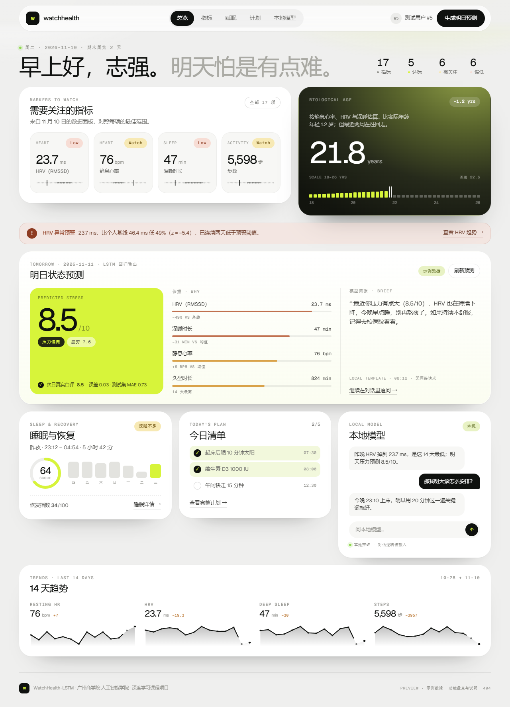
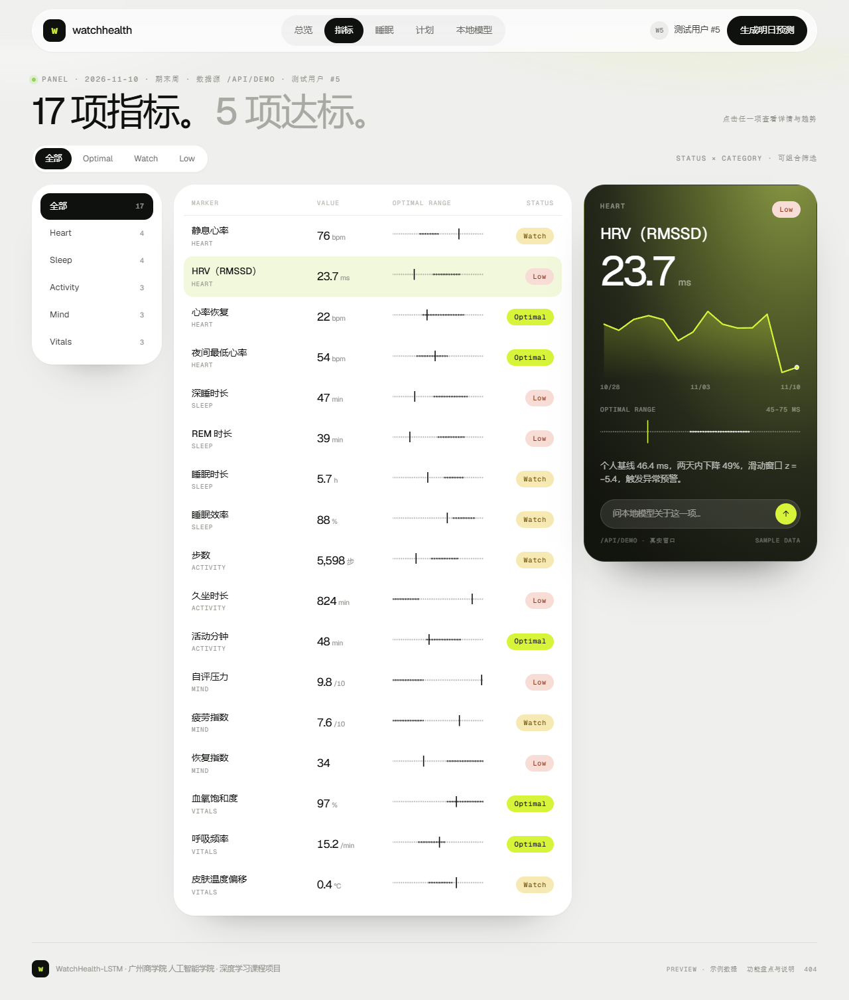
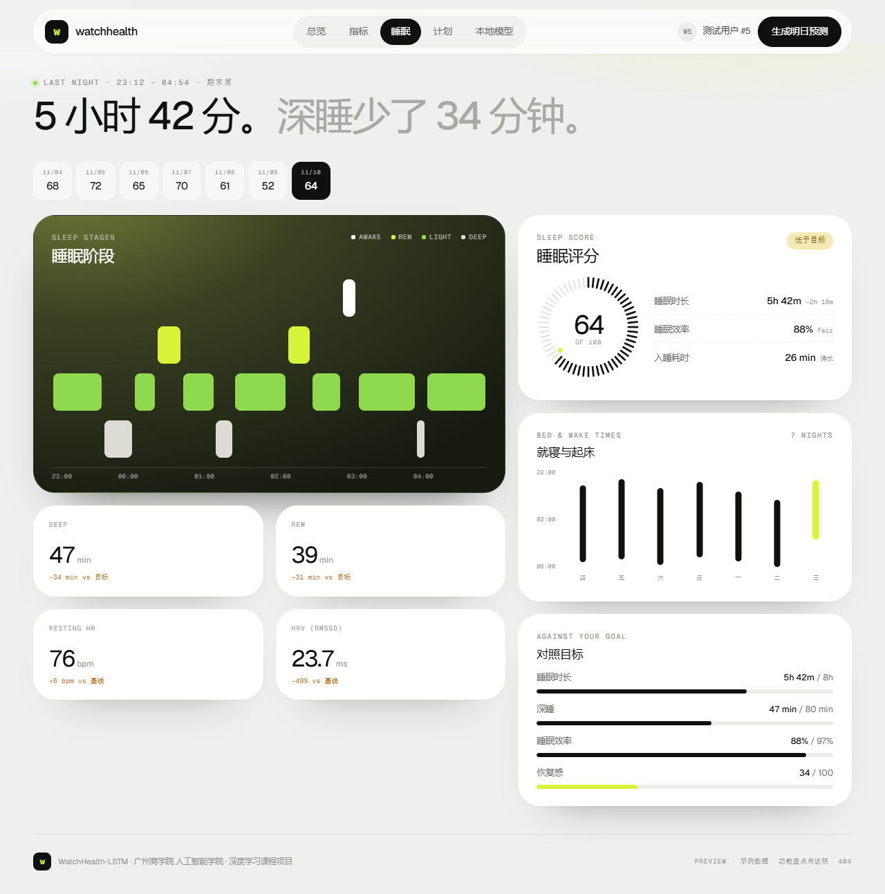
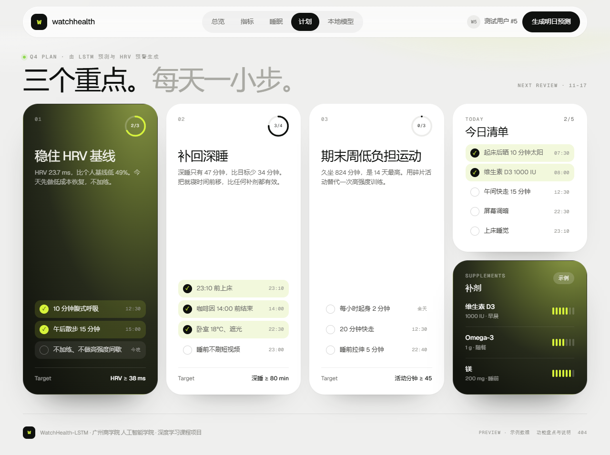
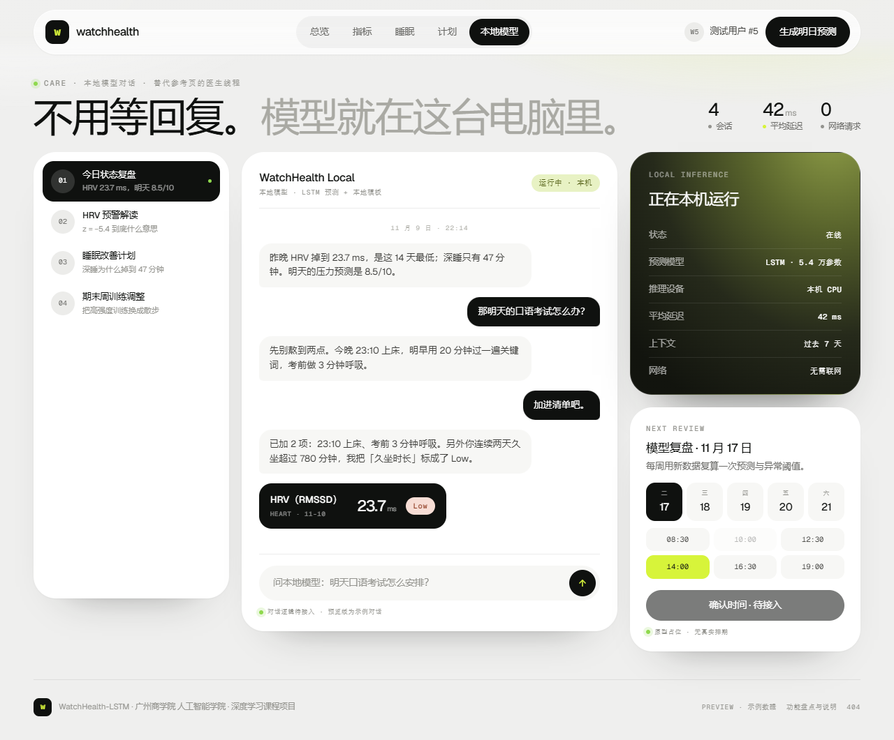
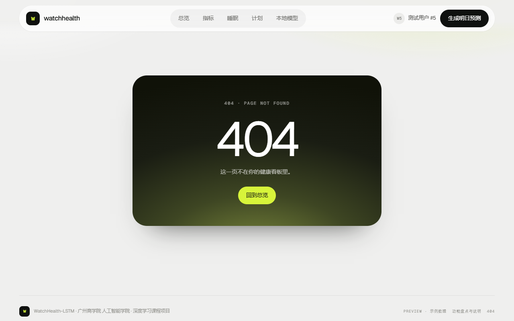
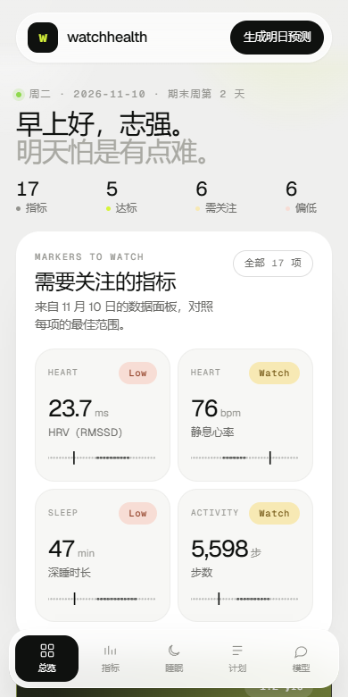

# 前端改版预览说明 · Mira Bio 风格

> 交付物：`presentation/index.html`（5 页 + 404 的静态预览）+ 本文档。
> 本次**不改动** `frontend/`、`backend/` 任何代码，所有数据为示例/占位数据。

---

## 0. 先看这里

| 项目 | 说明 |
|---|---|
| 预览入口 | `presentation/index.html`，双击即可打开（`file://` 直接运行，无需服务器、无需联网） |
| 依赖 | 无第三方 JS；`assets/fonts.css` 内嵌 Geist / Geist Mono（base64），断网也能保持排版 |
| 页面 | `#/overview` 总览 · `#/biomarkers` 指标 · `#/sleep` 睡眠 · `#/plan` 计划 · `#/care` 本地模型 · `#/404` |
| 数据 | 14 天序列取自 `data/processed/demo_data.csv` 测试用户 #5 第 18–31 天（与 `/api/demo` 同窗口）；其余为占位 |
| 交互 | 路由、筛选、指标详情、清单勾选、入场动画已实现；聊天/刷新预测/预约等**只到界面层**，点击会弹出「待接入」提示 |
| 评审重点 | ① 视觉与信息结构是否 OK ② 功能对照表（第 2 节）是否同意 ③ 两个必保功能的位置（第 5 节） |

---

## 1. 改造前：原前端盘点

### 1.1 页面 / 文件

| 文件 | 作用 |
|---|---|
| `frontend/index.html` | **唯一页面**（HTML + CSS + JS 全在一个文件，无路由、无组件化） |
| `frontend/lib/echarts.min.js` | 本地化的 ECharts（约 1 MB），用于 4 张 14 天折线 |
| `frontend/README.md` | 页面结构说明（中部 4 图 / 右侧 3 卡 / 一个预测按钮） |
| `backend/main.py` | 托管该页面，提供 `GET /api/demo`、`POST /api/predict` |

原页面只有一个路由 `/`，由 FastAPI 直接返回 `index.html`；没有前端框架、没有组件拆分。

### 1.2 页面区块（自上而下）

1. Header：品牌名 + 副标题 + 「测试用户：模型从未见过」徽标
2. 统计条：14 天平均静息心率 / HRV / 深睡 / 总步数（4 张卡）
3. 图表区：静息心率、HRV、深睡、步数 4 条 14 天折线（ECharts，各带一句 hint）
4. 右侧栏：
   - 主按钮「生成明日预测」
   - 预测卡：明日压力分（大数字）+ 档位标签（压力偏高 / 状态中等 / 状态良好）+ 疲劳分 + 建议
   - 预测 vs 真实对比行（`vsLine`）
   - HRV 异常预警卡（红色，含当前 HRV / 基线 / 降幅 / z 值）
   - AI 健康简报卡（讯飞星火生成，右下角标注来源 spark / template）
5. 状态文案（演示用户 #5、14 天窗口、模型未见过的用户）
6. Footer：学院署名

### 1.3 数据字段（后端契约，本次不改）

`GET /api/demo` →
`{ user_id, history[14] × { resting_hr, hrv_rmssd, deep_sleep_min, rem_min, steps, sedentary_min, prev_stress, next_stress }, actual_next }`

`POST /api/predict` →
`{ prediction: { stress, fatigue, advice }, anomaly: { alert, current_hrv, baseline_hrv, drop_pct, z_score, message }, brief: { text, source } }`

### 1.4 交互

加载即请求 `/api/demo` 并画 4 张图 → 点「生成明日预测」请求 `/api/predict` → 渲染预测 / 预警 / 简报；`?auto=1` 自动点一次（演示兜底）；窗口 resize 时重绘图表。

---

## 2. 功能对照表（保留 / 合并 / 弱化 / 替换）

判断原则：两个既有功能必须保留；健康数据、指标、睡眠、计划优先；只有与 Mira Bio 模块职责重复且无额外信息时才合并；所有「弱化/替换」写明理由。

| # | 原前端功能 | 原位置 | 判断 | 理由 | 对应 Mira Bio 位置（预览中） |
|---|---|---|---|---|---|
| 1 | 品牌名 / 副标题 / 「测试用户」徽标 | Header | **保留** | 品牌与数据可信度（“模型没见过的人”）是课程演示的关键说明 | Header 品牌 + 右上角用户 chip；Overview / 指标页的 mono 眉标注明「测试用户 #5」 |
| 2 | 4 项 14 天均值统计条 | `.stats` | **合并** | 均值只有配上趋势才有意义，单列一排浪费首屏 | Overview「需要关注的指标」4 张磁贴（数值 + 范围 + 状态）＋「14 天趋势」卡（当前值 / 变化量 / 走势） |
| 3 | 4 条 14 天折线图 | `#charts` | **保留**（实现方式替换） | 折线是核心信息，必须保留；但 ECharts 默认样式与 Mira 的安静风格冲突，且 1 MB 依赖与“离线单文件”目标相悖 | Overview「14 天趋势」4 条 sparkline；指标页详情卡内的大趋势图 |
| 4 | 「生成明日预测」按钮 | `#predictBtn` | **保留** | 项目最核心的动作 | Header 主按钮「生成明日预测」＋ Prediction Card 右上「刷新预测」 |
| 5 | 明日压力大数字 + 档位标签 | `#predCard` | **保留** | 核心功能，不得弱化 | Overview「明日状态预测」Prediction Card：8.5/10 + 「压力偏高」Status Chip |
| 6 | 疲劳指数 | `#fatigueVal` | **合并** | 后端是 `stress × 0.9` 的派生值，单列会挤占版面 | Prediction Card 里作为「疲劳 7.6」chip |
| 7 | 建议文案 `advice` | `#adviceVal` | **合并** | 与简报正文语义重复，两处都写会啰嗦 | 合并进「模型简报」正文与对话首条消息 |
| 8 | 预测 vs 真实对比 | `#vsLine` | **保留** | 论证模型有效性的关键证据（MAE 0.73） | Prediction Card 底部「次日真实自评 8.5 · 误差 0.03 · MAE 0.73」 |
| 9 | HRV 异常预警红卡 | `#alertCard` | **合并** | 预警只对 HRV 一项有意义，整张红卡在 Mira 风格里过重；但结论必须显眼 | Overview 顶部 Alert Strip（浅 blush）＋ 指标页 HRV 的 Low 状态 ＋ 详情卡 note（z = −5.4） |
| 10 | AI 健康简报（spark / 本地模板 + 来源） | `#briefCard` | **合并** | 一段人话简报与「模型简报」同质；来源标注保留 | Prediction Card「模型简报」块（来源以 mono 小字标注「Local template · 无网络请求」）＋ 对话首条消息 |
| 11 | 状态文案（用户 #5 / 窗口 / 未见过的用户） | `#status` | **合并** | 属于数据上下文，不该独占一行 | Header 用户 chip、Overview 眉标、指标页「数据源 /api/demo · 测试用户 #5」 |
| 12 | `?auto=1` 自动预测 | 脚本尾部 | **弱化** | 演示辅助开关，不是用户功能 | 预览不实现，正式版保留为调试参数 |
| 13 | 加载失败提示 `data.error` | `#status` | **弱化** | 预览是静态数据，不存在请求失败 | 正式版补 Error / Empty state（已列入待接入） |
| 14 | 双栏 grid 布局 + `chart.resize()` | `main` / JS | **替换** | 新版改为 12 栏 + 5 页结构 + 三档断点，图表用 viewBox 自适应，无需 resize 重绘 | 桌面 1240 居中 / 平板 / 手机（标签栏移到底部） |
| 15 | 页脚学院署名 | `footer` | **保留** | 课程项目署名 | 页脚 ＋ 「PREVIEW · 示例数据」标记 |
| 16 | ECharts 本地库 | `lib/echarts.min.js` | **弱化** | 预览改用内联 SVG（0 依赖、可离线、可动画）；正式版是否保留 ECharts 待评审决定 | 未引入；正式改造时再定 |

### 新增（参考页有、原前端没有）

| 模块 | 说明 | 位置 |
|---|---|---|
| 5 页导航 + 404 | Overview / Biomarkers / Sleep / Plan / Care + 404 | Header 标签栏 + 手机底部标签栏 |
| 生物学年龄卡 | 暗色渐变卡，年龄刻度轴（占位公式，非真实模型输出） | Overview |
| 睡眠页 | 睡眠阶段图、评分刻度盘、就寝/起床图、目标对照、4 项统计 | Sleep |
| 计划页 | 3 个重点领域 + 进度环、每日清单（可勾选）、补剂 | Plan |
| 指标分类 + 状态筛选 | 两个维度可组合，含空状态 | Biomarkers |
| 指标详情卡 | 趋势图 + 最佳范围 + 一句解读 + 追问入口 | Biomarkers 右侧（移动端在列表下方） |
| 本地模型对话页 | 会话列表、Chat Panel、Message Bubble、模型状态卡 | Care |
| 复盘预约卡 | Day Chip / Slot Chip / booking button（纯视觉占位） | Care 右栏 |
| Alert Strip | 把原红卡压成一条预警条 | Overview |
| Toast | 统一“待接入”反馈 | 全局 |

---

## 3. 17 项指标从哪来

需求要求列出 17 项；后端只有 7 个真实字段，因此：**7 项用真实窗口数据，10 项按生理先验构造占位序列**（确定性生成，每次打开一致）。

| 指标 | 分类 | 值 | 状态 | 最佳范围 | 数据来源 |
|---|---|---|---|---|---|
| 静息心率 | Heart | 76 bpm | Watch | 55–65 | `resting_hr` 真实 |
| HRV（RMSSD） | Heart | 23.7 ms | Low | 45–75 | `hrv_rmssd` 真实 |
| 心率恢复 | Heart | 22 bpm | Optimal | 20–40 | 占位 |
| 夜间最低心率 | Heart | 54 bpm | Optimal | 48–58 | 占位 |
| 深睡时长 | Sleep | 47 min | Low | 70–110 | `deep_sleep_min` 真实 |
| REM 时长 | Sleep | 39 min | Low | 70–100 | `rem_min` 真实 |
| 睡眠时长 | Sleep | 5.7 h | Watch | 7–8.5 | 占位 |
| 睡眠效率 | Sleep | 88 % | Watch | 90–97 | 占位 |
| 步数 | Activity | 5,598 | Watch | 8,000–12,000 | `steps` 真实 |
| 久坐时长 | Activity | 824 min | Low | 240–480 | `sedentary_min` 真实 |
| 活动分钟 | Activity | 48 min | Optimal | 45–90 | 占位 |
| 自评压力 | Mind | 9.8 /10 | Low | 1–4 | `prev_stress` 真实 |
| 疲劳指数 | Mind | 7.6 /10 | Watch | 1–4 | 占位（stress × 0.9） |
| 恢复指数 | Mind | 34 | Low | 60–100 | 占位 |
| 血氧饱和度 | Vitals | 97 % | Optimal | 96–100 | 占位 |
| 呼吸频率 | Vitals | 15.2 /min | Optimal | 12–16 | 占位 |
| 皮肤温度偏移 | Vitals | +0.4 °C | Watch | −0.2–0.3 | 占位 |

分布：Optimal 5 / Watch 6 / Low 6 —— 与首屏「17 项 · 5 达标 · 6 需关注 · 6 偏低」一致。

其余关键数字均取自真实窗口，保证与后方演示口径统一：

- 压力预测 **8.5 /10**，疲劳 **7.6**，次日真实自评 **8.5**（`actual_next = 8.47`），测试集 MAE 0.73
- HRV 基线 **46.4 ms** → 当前 **23.7 ms**，降幅 **49 %**，z ≈ **−5.4**（对应 `demo_notes.md` 的口播数字）
- 14 天序列、深睡 46.7→47、久坐 824、步数 5,598 均来自第 18–31 天窗口

### 3.1 日期与「期末周第几天」的标注口径

`demo_data.csv` **没有日期列**：每人 60 行按天索引存储，`/api/demo` 只是按行号切窗口（默认第 18–31 行）。所以：

- **日期是展示约定**：预览把窗口最后一天显示为「今天」（2026-11-10，周二），前 13 天依次前推（10/28–11/10）。后端不返回日期，正式版需要后端补 `date` 字段，或前端按天顺推后由数据驱动。
- **「期末周」来自合成脚本**：`model/synthesize_demo_data.py` 在第 30–37 天加了 `stress_wave = 2.5`（静息心率↑、HRV↓、深睡↓、久坐↑），用来模拟期末压力上升。窗口最后一行是第 31 天，即**模拟期末周的第 2 天**。
- 页面上最初写的「期末周第 12 天」没有数据依据（纯手写占位），已改为「期末周第 2 天」；日期之所以能显示，是因为预览用系统当天日期做了倒推，正式版应改为后端下发。

---

## 4. 设计还原说明

### 4.1 颜色 token（预览实际使用）

| token | 值 | 用途 |
|---|---|---|
| `--bg` | `#EFEFEE` | 页面底色（参考页同款暖灰） |
| `--surface` | `#FFFFFF` | 卡片 |
| `--surface-2/3` | `#F7F7F5` / `#ECECEA` | 内嵌卡、进度轨道 |
| `--ink` | `#0F110F` | 主文字、主按钮 |
| `--ink-2/3/4/5` | `#3E3E3B` / `#6B6B68` / `#94948F` / `#B6B6B0` | 次级文字 |
| `--lime` | `#D7F43A` | 强调色（达标、选中、预测分数块） |
| `--green` | `#8FD94E` | 次级绿（睡眠 Light、状态点） |
| `--lime-soft` | `#F2F8DC` | 完成态、浅色标签 |
| `--sand` | `#F7E9B4` | Watch 状态 |
| `--blush` | `#F7DDD5` | Low 状态、预警条 |
| `--grad-dark` | 橄榄绿 → 近黑径向渐变 | 生物年龄 / 详情 / 睡眠阶段 / 补剂 / 模型状态 / 404 |

参考页给出 22 个文本样式、37 个颜色 token；预览收敛为 **14 个文本样式 + 16 个颜色 token**（其余为这两组的透明度派生），命名与参考页一致，便于后续换皮。

### 4.2 文本样式（节选）

`display`（58/1.03/-0.036em）· `h2` 23 · `h3` 17 · `body` 14.5 · `body-sm` 13 · `small` 12 · `mono`（Geist Mono 10.5/0.13em 大写）· `value-xl`（76）· `value-lg`（47）· `value-md`（30）· `chip`（10.5 mono）· `link` 13 · `stat-label` 9.5 · `trend-label` 10.5。

中文走系统字体（PingFang / 微软雅黑），英文标签与数字走 Geist / Geist Mono，因此“中文正文 + 英文 mono 标签”的组合与参考页观感一致。

### 4.3 组件命名

参考页的命名组件在预览里一一对应：

| 参考组件 | 预览实现 |
|---|---|
| Header | `.nav` + `.brand` + `.tabs` + `.nav-right` |
| Marker Row | `.mrow`（指标列表行） |
| Category Item | `.cat-item`（分类侧栏） |
| Status Chip | `.chip.chip-optimal / -watch / -low` |
| Check Row | `.checkrow`（计划清单） |
| Clinician Item | `.thread`（改造为「会话项」） |
| Day Chip / Slot Chip | `.daychip` / `.slotchip` |
| Booking buttons | `.btn.btn-dark`（确认时间，disabled） |
| **Chat Panel（新增）** | `.chat-card` + `.chat-log` + `.chat-form` |
| **Message Bubble（新增）** | `.msg` + `.bubble` + `.msg-card`（指标卡片气泡） |
| **Prediction Card（新增）** | `.card.pred` + `.pred-score` + `.pred-basis` + `.pred-brief` |

---

## 5. 两个必保功能的呈现位置

### 5.1 明日状态预测（Prediction Card）

- **Overview 中部整行卡片**，是首屏最重的模块（浅色卡 + lime 分数块）。
- 结构：`PREDICTED STRESS 8.5/10` → 状态 chip「压力偏高」+「疲劳 7.6」→ **依据**（HRV / 深睡 / 静息心率 / 久坐，带强度条）→ **模型简报**（人话版 + 来源）→ 与真实自评的对照和 MAE。
- 「刷新预测」按钮：点击弹 Toast「刷新预测待接入 POST /api/predict」——**逻辑待实现**，界面与状态位已留好。
- Header 的「生成明日预测」会滚到这张卡并提示同样的信息。

### 5.2 本地模型聊天（Chat Panel）

- **完整页面 `#/care`**：左栏会话列表（今日状态复盘 / HRV 预警解读 / 睡眠改善计划 / 期末周训练调整），中栏对话，右栏「模型状态」+「复盘预约」。
- 消息气泡分左侧模型（浅灰）与右侧用户（黑色），中间可插入一张深色**指标卡片气泡**（HRV 23.7 ms / Low），对话内容直接引用 8.5 预测与 HRV 预警，形成“数据 → 结论 → 建议”的闭环。
- 输入框与发送按钮可用：输入后回车会追加用户气泡 + 打字指示器，随后出现一条虚线提示「预览版：本地模型接口尚未接入」，并弹 Toast —— **实际对话逻辑标注为待实现**。
- 输入框下方固定一行 mono 说明：`对话逻辑待接入 · 预览版为示例对话`。
- **Overview 右栏**另有迷你 Chat Panel（3 条气泡 + 输入框），点击「继续在对话里追问」跳到 Care 页；指标详情卡的「问本地模型关于这一项…」也会把问题带到 Care 页的输入框。
- 页头状态：`本地模型 · LSTM 预测 + 本地模板`、`运行中 · 本机`、`0 网络请求`——契合“本地模型”的定位（具体模型名可在正式版配置，预览未写死厂商）。

---

## 6. 交互实现状态

| 交互 | 状态 | 说明 |
|---|---|---|
| 5 页路由 / 标签栏 / 手机底部栏 | ✅ 已实现 | hash 路由，未知路由进 404 |
| 卡片与图表入场动画 | ✅ 已实现 | `rise` 逐卡延迟 + SVG 路径 `draw`；尊重 `prefers-reduced-motion` |
| 点击指标打开详情卡（趋势图） | ✅ 已实现 | 选中态 + 右侧详情更新 |
| 按状态（Optimal/Watch/Low）× 分类筛选 | ✅ 已实现 | 组合筛选、计数、空状态 |
| 每日清单勾选 | ✅ 已实现（内存态） | 两处清单同步计数 |
| 会话切换 / 选日期 / 选时段 | 🟡 仅视觉 | 选中态可用，弹「待接入」Toast |
| 本地模型对话 | 🟡 仅界面 | 输入 → 打字指示器 → 待接入提示 |
| 刷新 / 生成明日预测 | 🟡 仅界面 | Toast「待接入 POST /api/predict」 |
| 数据加载 | 🟡 静态示例 | 正式版接 `/api/demo`，接上后删掉内置 SERIES |
| 错误 / 空数据态 | ⬜ 未做 | 正式版补 |
| 登录 / 账号切换 | ⬜ 不做 | 参考页也没有登录 |

所有“待接入”都通过右上角/底部 Toast 明确提示，不会让评审误以为已经跑通后端。

---

## 7. 与参考页的差异

1. **Care 页换成模型对话**：参考页是“真人医生 + 在线状态 + 预约”；本项目没有医生资源，改成与本地模型对话，保留同样的三栏骨架、气泡形态、输入框与预约卡位置。
2. **预约卡降级为「模型复盘」占位**：没有真实排期系统，只保留 Day/Slot chip 的交互外观，并标注“原型占位 · 无真实排期”。
3. **趋势图不再依赖图片/CMS**：参考页的曲线是 CMS 里的图片；本预览用 14 天真实序列现算 SVG，接真实接口后自动更新。
4. **中文为主**：标题、正文、清单是中文，仅 mono 小标签用英文，保证中文评审一眼能读。
5. **生物学年龄、补剂、部分指标是占位**：项目没有这些真实输出，按参考页结构补位，并在文档与页面上标注示例。
6. **没有做参考页的“Book next test”**：换成「生成明日预测」主按钮。
7. **规模**：参考页 5 页 + 404，本预览同样 5 页 + 404；未做 CMS 后台与多语言。

---

## 8. 预览覆盖情况

| 页面 | 已覆盖区块 |
|---|---|
| Overview | 眉标 + 双色大标题 + 4 项统计 · 需关注指标（4 磁贴）· 生物学年龄 · HRV 预警条 · 明日状态预测（分数/依据/简报/验证）· 睡眠与恢复 · 今日清单 · 本地模型（迷你）· 14 天趋势 |
| Biomarkers | 17 项列表（Marker/Value/Optimal range/Status）· 分类侧栏（含计数）· 状态筛选 · 组合筛选 · 空状态 · 右侧详情卡（趋势/最佳范围/解读/追问） |
| Sleep | 睡眠阶段图（Awake/REM/Light/Deep + 时间轴）· 评分刻度盘 · 时长/效率/入睡耗时 · 就寝与起床 7 晚 · 目标对照 · 4 项统计卡 |
| Plan | 3 个重点领域（进度环 + 清单 + Target）· 今日清单（5 项，可勾选）· 补剂 |
| Care | 会话列表 · Chat Panel（示例对话 + 指标气泡 + 输入）· 模型状态卡 · 复盘预约卡 |
| 404 | 暗色渐变卡 + 返回总览 |

三档响应式：≥1080 桌面（12 栏）、768–1080 平板（2 栏/单栏混合）、≤820 手机（单栏 + 底部标签栏，390 px 实测无横向滚动）。

---

## 9. 正式改造时怎么落地（待确认后执行）

1. 保留 FastAPI 托管方式，`frontend/index.html` 拆成 `app.js` + `styles.css` + 6 个视图片段（或迁移到 Vue，视评审意见）。
2. 把预览里的 `MARKERS` 常量替换成 `/api/demo` 映射：7 个真实字段 → 7 项；其余 10 项需后端补字段或标记“待接入”。
3. 预测卡绑定 `POST /api/predict`：`prediction.stress/fatigue/advice`、`anomaly.*`、`brief.text/source` 一一对应，来源标注沿用现有文案。
4. 本地模型对话：新增 `POST /api/chat`（本机推理），前端接流式返回；未接入时保留占位提示。
5. 17 项指标的“最佳范围”需要一份阈值配置（当前写在前端 MARKERS 里），建议后端下发。
6. 删除 `?auto=1` 之外的演示辅助代码，补错误态与空数据态。

---

## 10. 文件清单

```
presentation/
├─ index.html                       ← 预览页（5 页 + 404，单文件应用逻辑）
├─ assets/fonts.css                 ← Geist / Geist Mono（base64 内嵌，离线可用）
├─ 前端功能盘点与预览说明.md          ← 本文档
└─ assets/preview/*.png             ← 各页预览截图（评审用，非运行依赖）
```

打开方式：

```text
双击 presentation/index.html
或浏览器打开 file:///…/presentation/index.html#/overview
```

无构建、无 npm、无网络请求；断网可完整演示。

---

## 附：预览截图

**Overview（总览）**


**Biomarkers（17 项指标 + 详情卡）**


**Sleep（睡眠阶段 / 评分 / 就寝）**


**Plan（三个重点 / 清单 / 补剂）**


**Care（本地模型对话）**


**404**


**手机端（390 px，标签栏移到底部）**


